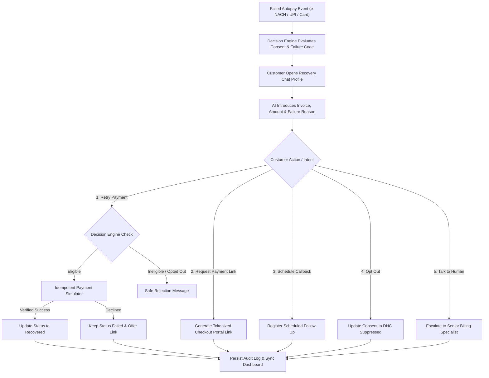

# RecoverAI

**Autonomous, Chat-First Autopay Recovery Platform**  
*Turning recurring payment failures into verified recoveries through transparent AI conversations and deterministic financial controls.*

---

## Overview

Subscription and B2B SaaS businesses lose significant revenue to recurring autopay failures—driven by temporary gateway timeouts, balance timing mismatches, expired cards, and mandate expirations. Traditional recovery relies either on passive dunning emails with low response rates or aggressive call centers that are costly, intrusive, and compliance-sensitive.

**RecoverAI** replaces blunt dunning with an intelligent, **chat-first recovery experience**. When an autopay transaction fails, RecoverAI presents the customer with an authenticated, contextual conversation:
1. Explains why the debit failed in clear terms.
2. Accurately references the invoice ID, amount, and bank failure reason.
3. Enables self-serve resolution across five distinct customer paths.
4. Validates all actions through a backend decision engine before executing simulated transactions.

---

## Key Innovations

### AI Interprets Intent — The Backend Controls Money
Generative AI and language models excel at dialogue, empathy, and intent classification, but they must **never** directly mutate financial ledgers. RecoverAI strictly decouples conversational interaction from financial execution:

| Dimension | Traditional Dunning | Unconstrained AI Bot | RecoverAI Approach |
| :--- | :--- | :--- | :--- |
| **Channel** | Static email / SMS blast | Open-ended chatbot | Contextual chat inside customer recovery drawer |
| **Financial Authority** | Hardcoded batch cron | LLM triggers APIs directly | **Deterministic Decision Engine controls all mutations** |
| **Double-Charge Risk** | Manual retry collisions | Non-deterministic prompt retries | **Strict Idempotency Keys** (`idempotency_key`) |
| **Card Data Handling** | Often captured in forms | Risk of prompting for raw card details | **Zero Card-Data Guard**: Blocks PAN/CVV/OTP in chat |
| **Compliance** | Delayed opt-out handling | Ignored unless programmed | **Instant DNC enforcement** suppressing all outreach |

---

## How It Works



---

## Core Features

### 1. Contextual AI Recovery Chatbox
- **Transparent Identity**: Introduces itself openly as an automated recovery assistant acting on behalf of the merchant.
- **Five Customer Recovery Paths**:
  - **Retry Payment**: Triggers simulated instant debit if permitted by eligibility rules.
  - **Request Payment Link**: Dispatches a portal link for manual completion via preferred payment methods.
  - **Schedule Callback**: Books a follow-up with accounts operations during business hours.
  - **Opt Out**: Enforces immediate Do Not Contact (DNC) compliance.
  - **Talk to Human**: Connects the customer directly to human support.
- **Persistent Conversation**: History is saved in SQLite and restored across user sessions.

### 2. Deterministic Decision Engine
- **Single Source of Truth**: Evaluates customer consent, payment state, and failure codes before authorizing any action.
- **State Invariant Enforcement**:
  - Blocks retries on already recovered invoices (`400 Bad Request`).
  - Blocks retries for opted-out accounts (`403 Forbidden`).
  - Matches remediation strategy to the failure code (e.g., immediate retry for network timeouts; portal links for card expiry).

### 3. Idempotent Payment Simulator
- **Safe Transaction Simulation**: Payment status is updated to `recovered` **only** upon verified confirmation from the simulator.
- **Idempotency Guarantee**: Every retry requires an `idempotency_key`. Redundant requests return the original transaction record (`is_duplicate: true`) without double processing.
- **Explicit Labeling**: Every simulated transaction generates a unique reference (`SIM-TXN-...`) and is labeled as simulated.

### 4. Operations Dashboard
- **Executive Metrics**: Failed Autopay Cohort, Total Amount at Risk, Total Recovered Amount, and Real-Time Recovery Rate.
- **Customer Slide-Over Drawer**: Houses the customer profile, failed payment diagnostics, and the embedded live AI chat interface.
- **Real-Time State Synchronization**: Updating customer state or recovering a payment via chat immediately reflects across all dashboard KPIs.

---

## Architecture & Technology Stack

```
RecoverAI/
├── backend/
│   ├── app/
│   │   ├── routes/
│   │   │   ├── customers.py        # Customer retrieval endpoints
│   │   │   ├── recovery.py         # Decision engine evaluation routes
│   │   │   ├── chat.py             # Chat history, messaging & reset routes
│   │   │   ├── payments.py         # Payment retry simulator & audit trail
│   │   │   └── vapi.py             # Telephony status & webhook signature verification
│   │   ├── services/
│   │   │   ├── decision_engine.py  # Recovery policy evaluation logic
│   │   │   ├── chat_engine.py      # Dialogue management & intent classification
│   │   │   ├── payment_simulator.py# Deterministic retry simulation & idempotency
│   │   │   └── vapi_service.py     # Optional telephony integration service
│   │   ├── schemas/                # Typed Pydantic models
│   │   ├── config.py               # Safe environment configuration & credential masking
│   │   ├── database.py             # SQLite engine & session management
│   │   ├── models.py               # SQLAlchemy models (Customer, Payment, ChatMessage, etc.)
│   │   └── main.py                 # FastAPI application entrypoint
│   ├── recoverai.db                # SQLite database with 10 seed customer records
│   ├── seed.py                     # Deterministic database seeder
│   └── requirements.txt            # Python dependencies
└── dashboard/                      # React frontend application
    ├── src/
    │   ├── components/
    │   │   ├── chat/
    │   │   │   └── AiRecoveryChatbox.jsx # Embedded AI chat interface
    │   │   ├── customers/
    │   │   │   ├── CustomersView.jsx     # Customers table with spacing system
    │   │   │   └── CustomerDetailPanel.jsx# Slide-over customer profile & chatbox
    │   │   ├── overview/                 # KPI metric cards & breakdown charts
    │   │   └── common/                   # Reusable UI badges, slide-overs, modals
    │   ├── context/
    │   │   └── RecoveryContext.jsx       # Global application state management
    │   └── App.jsx
    ├── package.json
    └── vite.config.js
```

### Technology Matrix

| Layer | Technologies | Role |
| :--- | :--- | :--- |
| **Backend API** | FastAPI, Python 3.12, Uvicorn | High-performance asynchronous REST endpoints |
| **Data Validation** | Pydantic V2 | Strict schema validation for all API inputs and outputs |
| **Database & ORM** | SQLite, SQLAlchemy 2.0 | Relational persistence for customers, payments, chat, and audit events |
| **Frontend UI** | React 18, Vite 5, Tailwind CSS | Responsive SaaS dashboard and interactive slide-over chatbox |
| **Icons & Visuals** | Lucide React | Clean, standard UI iconography |
| **Testing** | Pytest, Starlette TestClient | Automated integration test suite |

### Key API Endpoints

| Method | Endpoint | Description |
| :--- | :--- | :--- |
| `GET` | `/health` | Service and database connectivity health check |
| `GET` | `/api/customers/` | List all customer profiles and payment statuses |
| `GET` | `/api/recovery/decision/{payment_id}` | Decision engine recommendation for a given payment |
| `GET` | `/api/chat/{customer_id}` | Retrieve or initialize conversation history with AI introduction |
| `POST` | `/api/chat/{customer_id}/message` | Send customer message, evaluate intent, and execute safe action |
| `POST` | `/api/payments/{payment_id}/retry` | Execute simulated payment retry with idempotency key |
| `GET` | `/api/payments/{payment_id}/simulations`| Retrieve retry history and audit trail for a payment |

---

## Security, Guardrails & Reliability

1. **Zero Card-Data Storage Pattern**:
   - The chat engine evaluates user input against card number patterns (13–19 digits), CVVs, and OTPs.
   - Any sensitive input is immediately blocked from persistence, and the customer is warned to use tokenized checkout links instead.
2. **Idempotency Protection**:
   - Prevents duplicate debits caused by network retries or repeated button clicks.
   - Idempotency keys are checked against `payment_simulations`; duplicate requests return cached results without re-executing.
3. **Regulatory Opt-Out Compliance**:
   - Customer opt-out choices immediately update `consent_status = "opted_out"`.
   - All subsequent automated recovery attempts are suppressed at the backend layer.
4. **Verified State Transitions**:
   - Frontend components cannot directly set payment status to `recovered`.
   - Invoices are only transitioned upon confirmed success from the backend payment simulator.
5. **Telephony Note**:
   - The optional Vapi telephony integration module is configured for credential verification and webhook signature validation. Outbound voice calling is intentionally out of scope for this chat-first implementation.

---

## Screenshots

<!-- Note: Add screenshots after launching the dashboard -->

| Customer Recovery Profile & Live Chat | Operations Overview & Analytics |
| :---: | :---: |
| *Slide-over customer recovery profile showing the live AI Recovery Chatbox, failed invoice diagnostics, and 5 interactive recovery chips.* | *Executive KPI dashboard displaying real-time recovery rates, amount at risk, cohort distribution, and customer table.* |

---

## Local Setup & Execution

### Prerequisites
- Python 3.10+
- Node.js 18+ and npm

### 1. Backend Setup

```bash
# Navigate to the backend directory
cd backend

# Create and activate a virtual environment
python -m venv venv

# Windows (PowerShell):
.\venv\Scripts\Activate.ps1
# macOS/Linux:
source venv/bin/activate

# Install dependencies
pip install -r requirements.txt

# (Optional) Seed database if starting fresh
python seed.py

# Start the FastAPI server
python -m uvicorn app.main:app --reload --port 8000
```
- API Base URL: `http://localhost:8000`
- Interactive Swagger Docs: `http://localhost:8000/docs`

### 2. Frontend Dashboard Setup

```bash
# In a new terminal, navigate to the dashboard directory
cd dashboard

# Install frontend dependencies
npm install

# Start the Vite development server
npm run dev
```
- Dashboard URL: `http://localhost:5173`

---

## Testing & Verification

The project includes an automated test suite verifying decision engine policies, chat workflows, security guards, and simulator idempotency.

```bash
# Run all automated tests from the repository root
pytest backend/test_phase1.py backend/test_phase2_vapi.py backend/test_phase3_chat.py -v
```

### Verified Test Results

```
============================= test session starts =============================
platform win32 -- Python 3.12.10, pytest-9.2.0, pluggy-1.7.0
rootdir: RecoverAI
collected 38 items

backend/test_phase1.py ................. [17 PASSED]
backend/test_phase2_vapi.py ............ [ 6 PASSED]
backend/test_phase3_chat.py ............ [15 PASSED]

======================== 38 passed in 6.21s ========================
```

### Test Coverage Highlights
- **17 Tests (Core & Decision Engine)**: Health checks, customer retrieval, consent verification, and failure reason classification.
- **6 Tests (Configuration & Webhooks)**: Safe credential masking, assistant prompt compliance, and webhook signature validation.
- **15 Tests (Chat-First & Simulator)**: Transparent AI introductions, all 5 intent flows, zero card-data rejection, payment simulator idempotency, opt-out suppression, and SQLite persistence.

### Production Build Verification

```bash
cd dashboard
npm run build
```
```
✓ 2119 modules transformed.
dist/index.html                          1.34 kB
dist/assets/index-Cs-ghknN.css          37.05 kB
dist/assets/index-WKY019XY.js          152.56 kB
dist/assets/vendor-charts-Cxf1M4la.js  531.00 kB
✓ built in 20.97s (0 errors)
```

---

## Conclusion

RecoverAI demonstrates a practical, production-oriented approach to recurring payment recovery: combining conversational AI to understand customer intent with deterministic backend controls to protect financial integrity. By eliminating aggressive dunning and preventing unauthorized state mutations, RecoverAI provides an enterprise-ready foundation for modern subscription autopay recovery.
